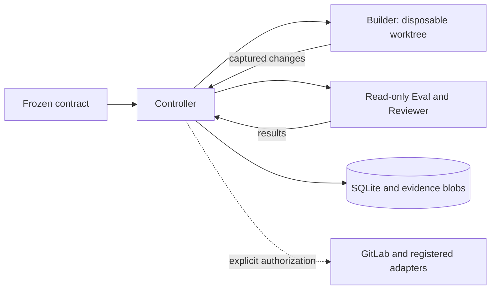

# Codex Quality Harness

English | [简体中文](README.zh-CN.md)

A local CLI for contract-driven Codex development, independent code review, and evidence-based quality gates.

**Status: experimental · Version: 0.1.0.** The local development loop has been validated on macOS. Linux CI runs the deterministic conformance suite; Linux worker isolation has not been validated. Windows is not currently supported.

[Installation](#installation) · [Quick start](#quick-start) · [Commands](#commands) · [Integration boundaries](#integration-boundaries) · [Contributing](#contributing)

## What it does

- Defines architecture, editable paths, acceptance checks, and repair budgets before development starts.
- Runs a Builder in a disposable worktree, then verifies captured changes with protected tests and an independent, read-only Reviewer.
- Associates evidence with source, runtime dependencies, contracts, and rules; changed inputs invalidate prior results.
- Persists operations in SQLite so an interrupted run can be inspected and reconciled without blindly repeating external writes.
- Reuses Git, Codex, GitLab CLI, and reviewed workflow scripts. The Python package has no third-party runtime dependencies.

## Requirements

| Component | Requirement |
|---|---|
| Python | Use a standalone Python 3.10 installation for the Controller and worker runtime. |
| Codex CLI | An authenticated installation supporting the permission profiles used here. Validated with `0.163.0`; other versions are unverified. |
| Git | Available on `PATH`; the target repository must have a committed baseline. |
| uv | Used by the installation instructions below. |
| GitLab CLI | `glab` with authorized access, only when using the GitLab integration. |

The GitLab host, publication/approval identity, Backend project policy, and production observation gateway are currently specific to the initial deployment. Adapt and verify these integrations before using them in another organization. Hosting this source on GitHub does not add a GitHub publication adapter.

## Installation

Install from a source checkout:

```bash
git clone https://github.com/yanjun11/codex-quality-harness.git
cd codex-quality-harness
uv tool install --editable . --python 3.10
qh --help
```

To load the optional Codex Skill, link the checkout into your personal skills directory. Run this from the repository root; the command deliberately refuses to overwrite an existing Skill:

```bash
mkdir -p "$HOME/.codex/skills"
test ! -e "$HOME/.codex/skills/quality-harness" && \
  ln -s "$PWD/skills/quality-harness" "$HOME/.codex/skills/quality-harness"
```

The [Skill](skills/quality-harness/SKILL.md) provides workflow instructions. CLI installation and authentication are separate prerequisites.

## Quick start

### 1. Prepare a committed example repository

Use a separate Git repository for the task. For a small demonstration, add these two files and commit them before calling `prepare`.

`calc.py` deliberately contains a bug:

```python
def add(a, b):
    return a - b
```

`tests/check.py` checks the same behavior against both the implementation and a known-bad replacement:

```python
import sys
import calc

if "--known-bad" in sys.argv:
    calc.add = lambda a, b: a - b

assert calc.add(2, 3) == 5
assert calc.add(-2, -3) == -5
```

### 2. Define the contract

Save this as `contract.json` outside the target repository. Paths inside the contract are relative to that repository:

```json
{
  "version": 1,
  "goal": "Return the sum of two integers without changing the public interface",
  "architecture": {
    "scope": ["calc.py"],
    "reuse": "Fix the existing add function",
    "data_model": "No database or model changes",
    "performance": "One integer operation; no network or database calls"
  },
  "risk": "low",
  "rubric": [{
    "id": "sum",
    "expected": "Positive and negative sums pass; subtraction must fail",
    "critical": true
  }],
  "tests": [{
    "id": "sum",
    "kind": "contract",
    "argv": ["python3.10", "tests/check.py"],
    "negative_argv": ["python3.10", "tests/check.py", "--known-bad"],
    "inputs": ["tests/check.py"]
  }],
  "budget": {"rounds": 3, "seconds": 1800},
  "base_ref": "HEAD"
}
```

### 3. Run and inspect

Replace the angle-bracket placeholders with your paths and the `run_id` returned by `prepare`:

```bash
qh prepare --repo <repo-path> --task DEMO-1 --contract <contract-path>
qh run --run <run-id> --until code_ready
qh status --run <run-id>
qh gate --run <run-id> --stage code_ready
```

`prepare` uses the specified Git baseline, not uncommitted edits in your original checkout. The Controller creates its own worktree and checks authentication and native isolation before the loop. Model calls consume your Codex usage.

This example omits external delivery: a local `code_ready` result does not prove CI, deployment, or production acceptance. Missing or failed isolation blocks execution. If runtime discovery fails, use `--runtime <standalone-python-3.10-root>` with `run` or `resume`.

## Commands

All six commands produce JSON by default. Use `qh <command> --help` for the complete flags.

| Command | Purpose |
|---|---|
| `doctor --repo <path>` | Inspect authentication, native permission probes, model tool probes, and CI reports. Model probes require `--live-codex`. |
| `prepare --repo <path> --task <id> --contract <file>` | Freeze a contract and prepare an isolated task worktree. |
| `run --run <id> --until <stage>` | Run development and verification up to a requested gate. |
| `gate --run <id> --stage <stage>` | Check evidence against current inputs and stage requirements. |
| `status --run <id>` | Inspect results, stale evidence, pending operations, and usage without invoking a model. |
| `resume --run <id>` | Continue only when unresolved operations have been handled. |

`doctor` retains an integration-specific M0 check: its aggregate result remains blocked without an explicit project/pipeline. Omitting `--live-codex` also leaves model probes blocked. Inspect individual checks; do not treat unexecuted checks as passes.

Exit codes: `0` pass, `1` fail, `2` blocked, `3` uncertain. Lifecycle, verification result, and evidence validity are separate values.

## Quality gates

| Stage | Required evidence |
|---|---|
| `draft_mr` | Confirmed publication when delivery is configured; this stage does not establish code quality. |
| `code_ready` | Valid isolation, required tests and negative controls, independent CR, and matching MR/CI evidence when delivery is configured. High-risk work also requires performance and risk evidence. |
| `test_accepted` | Code readiness, actual deployment identity and route hit, all required regression scenarios, and a verified report. |
| `production_ready` | TEST acceptance plus separately scoped readiness approval, capacity, specified-version observation, and recovery evidence. This is not deployment permission. |

The five fixed constraints apply throughout planning, implementation, and review:

| Principle | Requirement |
|---|---|
| Minimum necessary change | Declare scope and justify new files, modules, or dependencies. |
| Reuse first | Search existing implementations and extend them before adding another path. |
| Reuse data models | Justify necessary changes, compatibility, migration, and recovery limits. |
| Assess performance | Record changed work, evidence, gaps, risks, and recovery limits. Critical missing evidence blocks an unconditional pass. |
| Define before building | Freeze architecture and acceptance first. Lowering or removing requirements needs approval. |

## Architecture and isolation



- The Builder can write only declared business paths and authorized developer tests. Protected contracts, fixtures, mocks, selection settings, and CI inputs remain read-only. A disposable Builder path is never reused as the accepted workspace.
- Reviewer and Eval use restricted processes. Worker launches disable unscreened Apps, MCP servers, plugins, and hooks; command network access is disabled. `doctor` probes actual file and socket access, including protected-file replacement attempts.
- Critical checks need a protected known-bad negative control. Empty reports, missing jobs, skipped mandatory checks, fabricated local PASS values, and stale reviews cannot satisfy the gate. First failures are retained.
- Defaults are three repair rounds and 30 minutes, with two concurrent model slots and one Controller writer per task. Repeated failure without improvement blocks the loop. Infrastructure unavailability does not consume a repair round.

Source fingerprints are bounded to 20,000 files, 32 MiB per file, and 256 MiB total. Runtime content scans are bounded to 100,000 files, 128 MiB per file, and 2 GiB total. Exceeding a budget blocks verification; large environments require compatibility validation.

## Integration boundaries

GitLab delivery uses `run --publish` only after explicit delivery authorization and a valid final CR. It commits, pushes, creates or reuses a Draft MR, and reads back the Chinese CR comment. Publication does not merge or deploy. Required jobs are declared in advance; native merged-result identity is checked by default. A temporary merge is supplemental evidence.

Contracts can register reviewed scripts under `operations`, with structured `argv`, an exact environment/target, read-only `verify_argv`, and factual checks. Inspect `operation_scopes` in `status`, then use:

```bash
qh run --run <run-id> --operation <name> --approval <approval-file>
qh run --run <run-id> --operation <name> --reconcile
```

Deployment, database execution, regression screenshots, report readback, and production observation have adapter interfaces. Their scripts, permissions, and real environments still require validation. The current observation gateway and report expectations are organization-specific; these are not portable, preconfigured integrations.

Approval records bind the run, action, environment, commit, target, and script digest. They expire within one day and record the user's actual authorization; they are not cryptographic proof of human intent. Database/startup migration execution needs separate approval. Declared `database_operations` must match successful evidence for each exact dependency.

Use `{output}` in test arguments for reports and caches, with relative `junit`/`coverage` paths in the contract. Additional Python 3.10 environments require explicit `runtime_read_paths`. Changes to existing tests, acceptance, CI, or operational policy require a scoped contract-change approval. Unchanged Eval may be reused on matching inputs; an old CR is not reused across contract versions.

## State, recovery, and usage

The default Controller directory is `~/.local/state/codex-quality-harness/controller`; `doctor` writes separate M0 reports under `~/.local/state/codex-quality-harness/`. Controller directories are private, and raw artifacts are addressed by content digest. Keep credentials and raw evidence out of Git.

```bash
qh run --run <run-id> --cancel
qh resume --run <run-id> --reconcile
qh status --run <run-id> --backup <new-backup-path>
```

Cancellation requests termination and retains evidence. Reconciliation reads existing effects before proceeding; unknown outcomes remain visible. A live worker is not replaced on timeout, and a generic adapter is not confirmed solely because its parent PID disappeared. Backups use SQLite's backup API and refuse to overwrite an existing file.

`status` reports time and token usage. Pricing, efficiency improvement, and production latency are not inferred without real baselines. There is no continuous monitoring service. To roll back, stop using the new entry point and reinstall a known version; preserve state and unresolved operations. Do not blindly replay writes or reverse database migrations.

## Contributing

Report reproducible issues through [GitHub Issues](https://github.com/yanjun11/codex-quality-harness/issues). Include platform, Python/Codex versions, the relevant command, and redacted evidence.

Run deterministic checks from this checkout:

```bash
PYTHONPATH=src uv run --no-project --python 3.10 python -m unittest discover -s tests
```

These checks do not require model credentials. Actual model-loop, GitLab, TEST, and production acceptance are separate checks. Keep changes focused, preserve protected acceptance, and update both README versions for user-facing documentation changes.

## Attribution and licensing

The workflow includes [Ponytail](https://github.com/DietrichGebert/ponytail/tree/09c434ab73ca43761c5d8b0c5d341926c2fba710) guidance pinned to `09c434ab73ca43761c5d8b0c5d341926c2fba710`. Its original text and [MIT license](skills/quality-harness/references/PONYTAIL-LICENSE) are retained.

A license for the Harness code has not yet been declared. Public repository visibility does not itself grant an open-source license; the vendored Ponytail license applies to that material.
