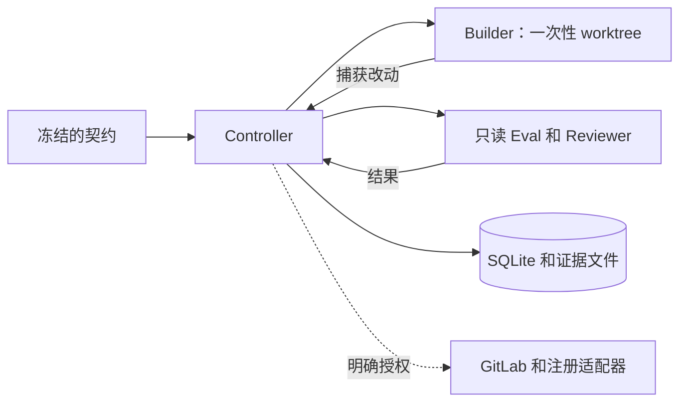

# Codex Quality Harness

[English](README.md) | 简体中文

在本机用验收契约驱动 Codex 开发、独立代码审查和基于证据的质量门禁。

**状态：实验性 · 版本：0.1.0。** 本机开发流程已在 macOS 验证。Linux CI 执行确定性测试，尚未验证 Linux 的 Worker 隔离。当前不支持 Windows。

[安装](#安装) · [快速开始](#快速开始) · [命令](#命令) · [集成边界](#集成边界) · [参与贡献](#参与贡献)

## 主要能力

- 开发前定义架构、可写路径、验收检查和修复预算。
- Builder 在一次性 worktree 中开发，捕获改动后交给受保护测试和独立只读 Reviewer 验证。
- 证据关联源码、运行依赖、契约和规则；输入变化后，旧结果失效。
- SQLite 持久保存操作，中断后可检查和对账，避免盲目重复外部写入。
- 复用 Git、Codex、GitLab CLI 和已审阅的流程脚本。Python 包没有第三方运行时依赖。

## 环境要求

| 组件 | 要求 |
|---|---|
| Python | Controller 和 Worker 运行时使用独立安装的 Python 3.10。 |
| Codex CLI | 已认证，且支持本项目使用的权限配置。已验证版本为 `0.163.0`，其他版本尚未验证。 |
| Git | 位于 `PATH` 中，目标仓库已有提交基线。 |
| uv | 下方安装步骤使用的工具。 |
| GitLab CLI | 使用 GitLab 集成时，需要已授权的 `glab`。 |

当前 GitLab 主机、发布与批准身份、Backend 项目策略及生产观测网关仍采用初始部署的专用配置。在其他组织使用前，需要调整并验证这些集成。源码托管在 GitHub 不代表已提供 GitHub 发布适配器。

## 安装

从源码安装：

```bash
git clone https://github.com/yanjun11/codex-quality-harness.git
cd codex-quality-harness
uv tool install --editable . --python 3.10
qh --help
```

如需加载可选的 Codex Skill，在仓库根目录执行以下命令。目标 Skill 已存在时，命令会拒绝覆盖：

```bash
mkdir -p "$HOME/.codex/skills"
test ! -e "$HOME/.codex/skills/quality-harness" && \
  ln -s "$PWD/skills/quality-harness" "$HOME/.codex/skills/quality-harness"
```

[Skill](skills/quality-harness/SKILL.md) 提供流程指引。CLI 安装和认证需要分别完成。

## 快速开始

### 1. 准备已提交的示例仓库

使用另一个 Git 仓库承载任务。下面的小例子包含两个文件，请先将它们提交，再调用 `prepare`。

`calc.py` 故意保留一个错误：

```python
def add(a, b):
    return a - b
```

`tests/check.py` 用同一组断言检查实际实现和已知错误实现：

```python
import sys
import calc

if "--known-bad" in sys.argv:
    calc.add = lambda a, b: a - b

assert calc.add(2, 3) == 5
assert calc.add(-2, -3) == -5
```

### 2. 定义验收契约

在目标仓库外保存 `contract.json`。契约内的路径均相对于目标仓库：

```json
{
  "version": 1,
  "goal": "返回两个整数之和，保留现有接口",
  "architecture": {
    "scope": ["calc.py"],
    "reuse": "修复现有 add 函数",
    "data_model": "无数据库或模型变更",
    "performance": "单次整数运算，无网络或数据库调用"
  },
  "risk": "low",
  "rubric": [{
    "id": "sum",
    "expected": "正负整数求和通过，减法错误实现必须失败",
    "critical": true
  }],
  "tests": [{
    "id": "sum",
    "kind": "contract",
    "argv": ["python3.10", "tests/check.py"],
    "negative_argv": ["python3.10", "tests/check.py", "--known-bad"],
    "inputs": ["tests/check.py"]
  }],
  "budget": {"rounds": 3, "seconds": 1800},
  "base_ref": "HEAD"
}
```

### 3. 执行并查看结果

将尖括号占位符替换为实际路径，以及 `prepare` 返回的 `run_id`：

```bash
qh prepare --repo <repo-path> --task DEMO-1 --contract <contract-path>
qh run --run <run-id> --until code_ready
qh status --run <run-id>
qh gate --run <run-id> --stage code_ready
```

`prepare` 读取指定 Git 基线，不包含原目录的未提交修改。Controller 创建独立 worktree，并在开发前检查认证和原生隔离。模型调用会消耗你的 Codex 用量。

此例没有配置外部交付。本机 `code_ready` 不代表 CI、部署或生产验收通过。隔离缺失或失败会阻断执行。运行时定位失败时，可为 `run` 或 `resume` 指定 `--runtime <standalone-python-3.10-root>`。

## 命令

六个命令默认输出 JSON。完整参数以 `qh <command> --help` 为准。

| 命令 | 用途 |
|---|---|
| `doctor --repo <path>` | 检查认证、原生权限探针、模型工具探针和 CI 报告；模型探针需要 `--live-codex`。 |
| `prepare --repo <path> --task <id> --contract <file>` | 冻结契约并准备任务 worktree。 |
| `run --run <id> --until <stage>` | 执行开发和验证，检查指定阶段门禁。 |
| `gate --run <id> --stage <stage>` | 按当前输入及阶段要求核验证据。 |
| `status --run <id>` | 查看结果、过期证据、待核对操作和用量，不调用模型。 |
| `resume --run <id>` | 处理不明操作后，继续执行。 |

`doctor` 仍包含初始集成的 M0 检查。不指定项目和流水线时，汇总结果会保持阻塞；不加 `--live-codex` 时，模型探针也保持阻塞。请查看分项结果，未执行的检查不能算通过。

退出码：`0` 通过、`1` 失败、`2` 阻塞、`3` 待核对。生命周期、验证结果和证据有效性分别记录。

## 质量门禁

| 阶段 | 必需证据 |
|---|---|
| `draft_mr` | 配置交付时，需要确认发布结果；此阶段不代表代码质量通过。 |
| `code_ready` | 有效隔离、必要测试与负例、独立 CR；配置交付时还需匹配的 MR/CI 证据。高风险任务另需性能和风险证据。 |
| `test_accepted` | 代码就绪、实际部署身份和路由命中、全部必验场景、已核验的报告。 |
| `production_ready` | TEST 验收、单独限定范围的就绪批准、容量、指定版本观测及恢复证据。它不授予发布权限。 |

方案、开发和 CR 始终执行以下五条约束：

| 原则 | 要求 |
|---|---|
| 最小必要改动 | 明确范围，说明新增文件、模块或依赖的必要性。 |
| 优先复用 | 先查已有实现，优先扩展现有能力。 |
| 默认复用数据模型 | 必要变更说明原因、兼容、迁移和恢复限制。 |
| 评估性能 | 记录工作量变化、证据、缺口、风险和恢复限制。高风险缺关键证据不能无条件通过。 |
| 先定义，再开工 | 先冻结架构和验收。降低或删除要求必须取得批准。 |

## 架构与隔离



- Builder 只写已声明的业务路径和授权开发测试。契约、Fixture、Mock、测试选择配置和 CI 输入保持只读。一次性 Builder 目录不会作为后续验收目录复用。
- Reviewer 和 Eval 使用受限进程。Worker 启动时禁用未经筛选的 Apps、MCP、Plugins 和 Hooks，命令网络关闭。`doctor` 实测文件和 socket 权限，也检查替换受保护文件的尝试。
- 关键检查必须有受保护的已知错误负例。空报告、缺失 Job、必验项跳过、伪造本地 PASS 或过期 CR 均不能放行。首次失败保留。
- 默认最多修复 3 轮、30 分钟；模型并发槽位最多 2 个，每个任务只有一个 Controller 写入者。同一失败持续无改善时阻塞；环境不可用不消耗代码修复轮数。

源码指纹最多扫描 20,000 个文件，单文件 32 MiB、总计 256 MiB。运行时内容扫描最多 100,000 个文件，单文件 128 MiB、总计 2 GiB。超出预算会阻断验证，大型环境需要先验证兼容性。

## 集成边界

GitLab 交付使用 `run --publish`。它要求明确的交付授权和有效的最终 CR，然后提交、推送、创建或复用 Draft MR，并回读中文 CR 评论。该动作不合并或部署。必需 Job 预先声明，默认核对原生合并结果身份；临时合并仅作补充证据。

契约可在 `operations` 注册已审阅脚本，声明结构化 `argv`、准确环境和目标、只读 `verify_argv` 及事实检查。先用 `status` 查看 `operation_scopes`，再执行：

```bash
qh run --run <run-id> --operation <name> --approval <approval-file>
qh run --run <run-id> --operation <name> --reconcile
```

部署、数据库执行、回归截图、报告回读和生产观测已提供适配器接口。实际脚本、权限和环境仍需逐项验收。当前观测网关及报告要求属于初始组织集成，尚未提供跨组织的现成配置。

批准记录绑定运行、动作、环境、提交、目标和脚本摘要，有效期不超过一天。记录必须来自用户的真实授权，不是人类意图的密码学证明。数据库或启动迁移执行需要单独批准；声明的 `database_operations` 必须逐项匹配准确依赖的成功证据。

测试参数用 `{output}` 定位报告和缓存，契约 `junit`、`coverage` 使用相对路径。额外 Python 3.10 环境用 `runtime_read_paths` 显式开放。更改已有测试、验收、CI 或运行策略需要限定范围的契约变更批准。输入匹配时可复用未变的 Eval，契约版本变化后不复用旧 CR。

## 状态、恢复与用量

Controller 默认目录为 `~/.local/state/codex-quality-harness/controller`。`doctor` 在 `~/.local/state/codex-quality-harness/` 下单独保存 M0 报告。Controller 目录仅当前用户可访问，原始产物按内容摘要保存。凭据和原始证据不要提交 Git。

```bash
qh run --run <run-id> --cancel
qh resume --run <run-id> --reconcile
qh status --run <run-id> --backup <new-backup-path>
```

取消会请求终止进程并保留证据。恢复先读取既有操作效果，结果不明的项继续显示。不会因超时替换仍存活的 Worker，也不会只凭父 PID 消失确认通用适配器完成。备份使用 SQLite backup API，拒绝覆盖已有文件。

`status` 统计时间和 Token。缺少真实基线时，不推断费用、效率提升或生产延迟。项目不包含持续监控服务。回退时停用新入口、重装已知版本，保留状态和待核对操作；不要盲目重复写入或反向执行数据库迁移。

## 参与贡献

在 [GitHub Issues](https://github.com/yanjun11/codex-quality-harness/issues) 提供可复现问题，附平台、Python/Codex 版本、相关命令和脱敏证据。

在本仓库运行确定性检查：

```bash
PYTHONPATH=src uv run --no-project --python 3.10 python -m unittest discover -s tests
```

这些检查不需要模型凭据。实际模型流程、GitLab、TEST 和生产验收分别执行。保持改动集中，保留受保护验收要求；变更面向用户的文档时，同步更新中英文 README。

## 致谢与许可

工作流引用 [Ponytail](https://github.com/DietrichGebert/ponytail/tree/09c434ab73ca43761c5d8b0c5d341926c2fba710) 指引，固定提交为 `09c434ab73ca43761c5d8b0c5d341926c2fba710`。保留上游原文及其 [MIT 许可证](skills/quality-harness/references/PONYTAIL-LICENSE)。

Harness 主项目尚未声明许可证。仓库公开不自动授予开源许可；Ponytail 的许可证仅适用于对应引用材料。
